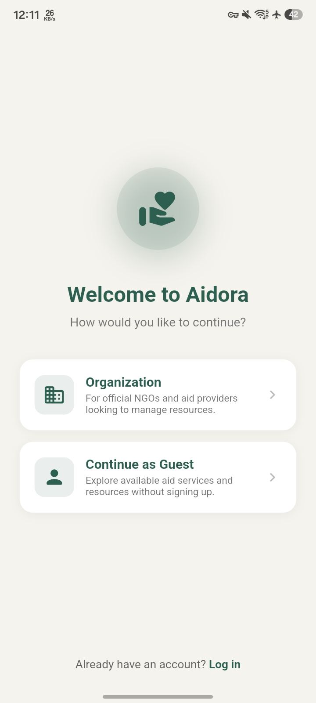
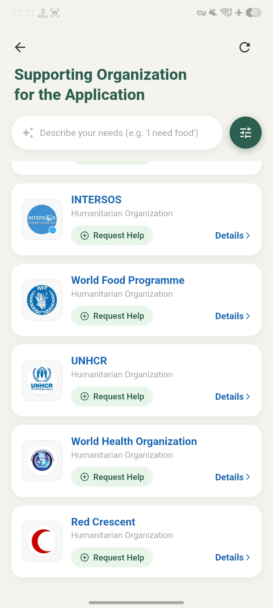
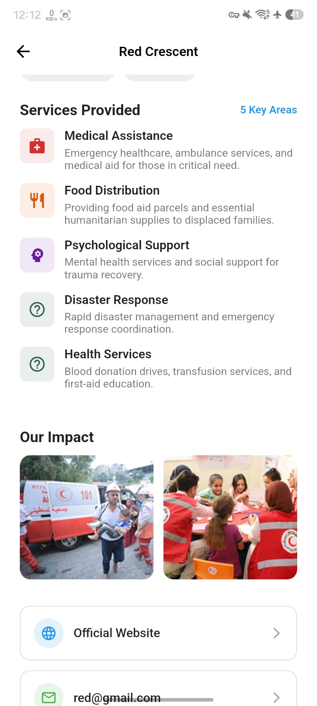
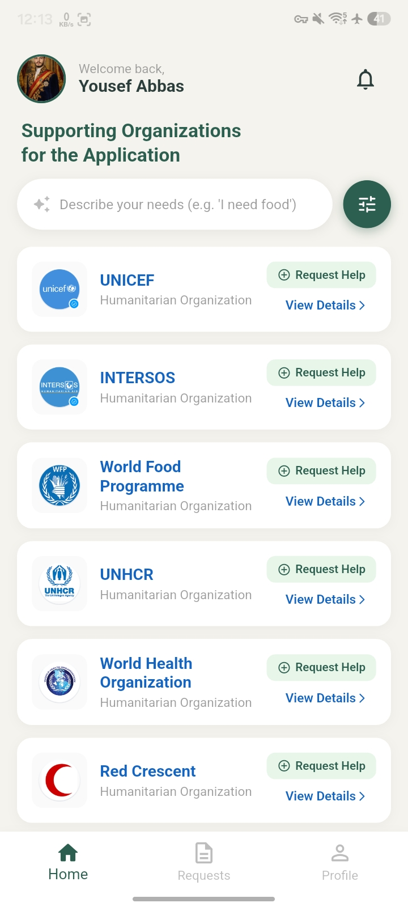
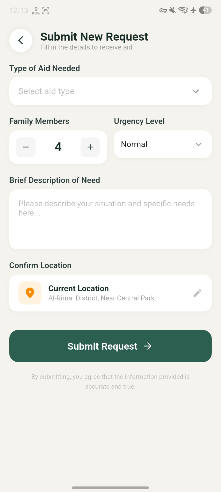
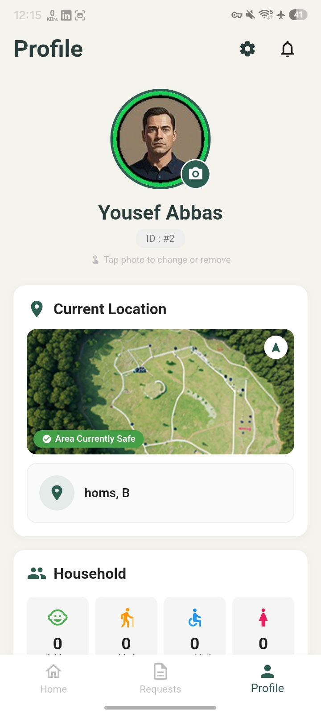

# Aidora — Humanitarian Assistance Coordination Platform

**A full-stack academic software engineering project** connecting displaced communities with humanitarian organisations and volunteers through a Flutter application and a Django REST API.

<p align="center">
  
</p>

<p align="center">
  
  
  
  
  
</p>

---

## Project at a glance

Aidora was developed as a fourth-year Informatics Engineering academic project. It addresses a practical coordination problem: people who need assistance, organisations that provide services, and volunteers who help deliver them often interact through fragmented processes.

The platform brings key workflows into one system:

- Discover humanitarian organisations and available services.
- Register and manage beneficiary and volunteer profiles.
- Submit and follow assistance requests.
- Support organisation-side request and service workflows.
- Coordinate volunteer tasks and QR-based completion checks.
- Provide Arabic and English user interfaces.

## My role

**I was responsible for the end-to-end technical design and implementation of Aidora.** My work covered the system architecture and the main engineering layers across the mobile client and backend.

- Defined the overall client–server architecture and application structure.
- Designed the database model and REST API structure.
- Implemented backend functionality with Django and Django REST Framework.
- Developed the Flutter application and its presentation, state-management, model, and service layers.
- Implemented and integrated authentication, role-aware workflows, and API communication.
- Worked across integration, debugging, and the consistency of behaviour between the client and server.

This project gave me practical experience taking an application from system design through implementation and integration.

## System architecture

Aidora uses a client–server architecture. The Flutter application communicates with a Django REST API, which applies application rules and persists data in PostgreSQL.

```text
┌────────────────────────────────────┐
│          Flutter Application       │
│  Screens · State · Models · Services│
└──────────────────┬─────────────────┘
                   │ HTTPS / REST / JSON
                   │ JWT authentication
                   ▼
┌────────────────────────────────────┐
│       Django REST Framework API    │
│                                    │
│  Accounts · Organisations · Requests│
│  Roles · Workflows · Validation     │
└──────────────────┬─────────────────┘
                   │ Django ORM
                   ▼
┌────────────────────────────────────┐
│             PostgreSQL             │
└────────────────────────────────────┘
```

### Main backend domains

| Domain | Responsibility |
|---|---|
| Accounts | User registration, authentication, profiles, OTP and password recovery |
| Organisations | Organisation profiles, services and organisation workflows |
| Service requests | Assistance requests, request lifecycle, volunteer tasks and QR completion |

### Main application layers

| Layer | Responsibility |
|---|---|
| Presentation | Screens, views, widgets and navigation |
| State management | Reactive state and controller coordination using GetX |
| Services | API communication, authentication and supporting operations |
| Models | Structured representation of API data |
| Backend API | Business rules, validation, authentication and persistence |

For additional detail, see [Architecture Overview](docs/architecture.md) and [Backend Documentation](backend/README.md).

## Key capabilities

- JWT-based authentication and token workflows.
- Registration and OTP verification.
- Role-aware beneficiary, volunteer and organisation workflows.
- Organisation and service discovery.
- Assistance request creation and lifecycle management.
- Volunteer task coordination and QR-based completion verification.
- Profile and image management.
- Arabic and English localisation.
- API documentation through OpenAPI/Swagger UI.

## Technology stack

| Area | Technologies |
|---|---|
| Mobile and UI | Flutter, Dart, GetX |
| Backend | Python, Django, Django REST Framework |
| Data | PostgreSQL |
| API and authentication | REST, JSON, JWT |
| Device capabilities | Image picker, local notifications, QR scanning |
| Development | Git, GitHub Actions, Docker, Docker Compose |
| Testing and quality | Flutter Test, Mockito, Django tests, static analysis |

Dependency versions and implementation details are maintained in [pubspec.yaml](pubspec.yaml) and [backend/requirements.txt](backend/requirements.txt).

## Repository structure

```text
Aidora/
├── lib/                         # Flutter application source
│   ├── controllers/
│   ├── models/
│   ├── services/
│   ├── utils/
│   ├── views/
│   └── widgets/
├── test/                        # Flutter tests
├── backend/                     # Django REST API
│   ├── accounts/
│   ├── organizations/
│   ├── service_requests/
│   └── tests/
├── docs/                        # Architecture and engineering notes
├── .github/workflows/           # CI workflows
├── images/                      # Application assets
└── README.md
```

## Run locally

### Flutter client

Requirements: Flutter SDK compatible with the Dart constraint in `pubspec.yaml`.

```bash
git clone https://github.com/YousefAbaas/Aidora.git
cd Aidora
flutter pub get
flutter analyze
flutter test
flutter run
```

### Django backend

See [backend/README.md](backend/README.md) for Python, PostgreSQL, environment configuration, and Docker Compose instructions.

Do not commit local environment files, database credentials, signing keys, tokens, or production data.

## Engineering documentation

- [Architecture Overview](docs/architecture.md)
- [Engineering Decisions](docs/engineering-decisions.md)
- [CI/CD Notes](docs/ci-cd.md)
- [Backend Setup and API](backend/README.md)
- [API Integration Guide](API_INTEGRATION_GUIDE.md)

## Screenshots

<p align="center">
  
  
  
  
  
  
</p>

## Academic context

Aidora was developed as part of the Informatics Engineering programme at Homs University. It represents applied work in requirements-to-implementation development, client–server architecture, API design, data modelling, mobile development, and software integration.

## Licence

This project is distributed under the [Apache License 2.0](LICENSE).
